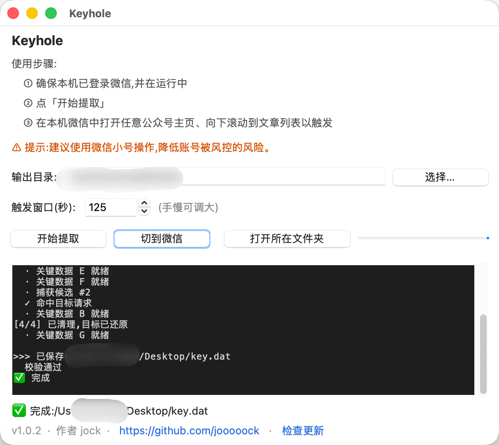

# Keyhole

提取本机**已登录微信**的会话态,脱离客户端 UI 抓取公众号文章(学术 / 研究用途)。
桌面应用双击即用,内置「检查更新」;成功后在输出目录生成加密会话文件 `key.dat`。

## 下载

| 平台 | 下载 |
|---|---|
| macOS(Apple Silicon) | **[Keyhole-macos-arm64.dmg](https://dl.zoro.build/keyhole/download/mac)** |
| Windows(x64) | **[Keyhole-windows-x64.exe](https://dl.zoro.build/keyhole/download/win)** |

经 `dl.zoro.build` 反代,国内可达;也可在 [Releases](../../releases/latest) 直接下载。

## 使用

1. 电脑端**登录并运行微信**。
2. 打开 Keyhole,点「开始提取」。
3. 到微信里**打开任意公众号主页、向下滚动到文章列表**触发。
4. 成功后在输出目录(默认桌面)生成 `key.dat`。

> 建议使用微信**小号**操作,降低账号被风控的风险。

## 安装注意

**macOS**(Apple Silicon):
- 一次性:关闭 SIP(恢复模式 `csrutil disable`)+ `sudo sysctl -w vm.cs_library_validation=0`。
- 首次运行前去隔离位:`xattr -dr com.apple.quarantine /Applications/Keyhole.app`。

**Windows**:双击允许 UAC(需管理员);SmartScreen / 杀毒告警点「更多信息 → 仍要运行」/ 放行。

---
学术 / 研究用途;仅提取你自己机器上已登录微信的会话。
